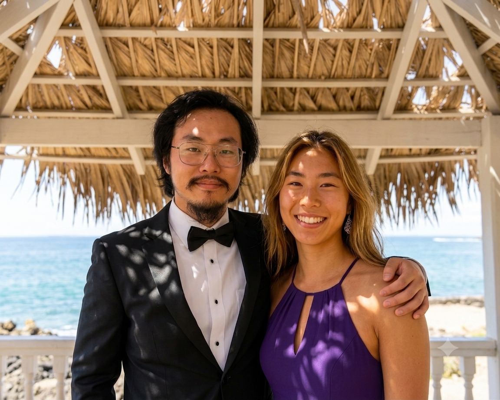

## There are strange happenings going on or brewing. (11/12/2026)

I'll keep this description of myself short. I live in the United States, and I am not currently employed by anyone. 
If my fate were left to the capital markets, I would have sadly ended up as a corporate shill or sold into even 
more disparity by now. 

I tend to not delve into socioeconomic and political matters since my formal education did not specialize me for those 
topics. But a lot of people, Americans included, have no problem talking out of their asses. So I too could not help 
but publish to Github more than just a few pieces that at least touch on politics and socioeconomics. 

The software industry has become a dangerous industry now. The competition is as stiff as a multi-national criminal 
conspiracy. 

**On the pessimistic side, education is never enough, and industry betrays.** 

See [this link](https://github.com/Changissnz/previous_github_profile_intro__11-03-2026) for my previous Github 
introduction. 

Right now, I have decided to take it easy with working in software, since the major software corporations have been 
hiring mainly blacks and Indians, due to disadvantaged backgrounds. 

It's cool, though. I definitely know how to live life, such as spending time with **my beautiful blonde girlfriend 
every day**, all the minutes we will share now that I don't have to do software that much (A.I. can do software, hee hee!). 

